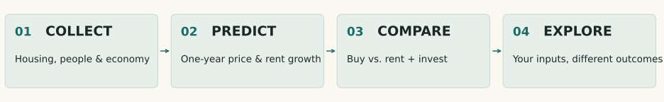
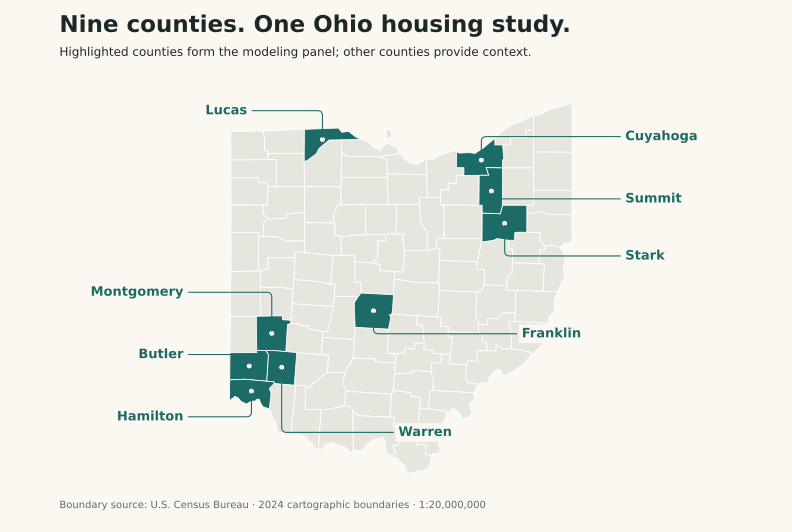

# Rent or Buy? A Data-Driven Analysis of Ohio Housing Markets

**Nine Ohio counties · Quarterly observations, 2015–2025 · One-year housing forecasts · Rent-versus-buy scenarios**

Can local housing, demographic, and economic conditions help predict how home values and rents will change over the next year? We build a county-by-quarter dataset, compare forecasting models, and use the selected predictions in a rent-versus-buy financial calculator.

**[Try the interactive calculator](https://htmlpreview.github.io/?https://github.com/Erdos-Projects/fall-2026-rent-or-buy/blob/repository-clean-up/financial_calculator.html)** · [Read the model-comparison report](docs/checkpoint4_model_compare.md) · [View the calculator source](financial_calculator.html)

> **ABOUT THE DEMO:** Explore **HISTORICAL DECISION QUARTERS** using model forecasts for **2023Q1–2025Q4**. A **2025 decision predicts the same quarter in 2026**; those actual one-year outcomes are **NOT AVAILABLE IN THE PROJECT DATA**. Historical outcome mode covers 2015Q1–2024Q4. This is **NOT A LIVE FORECAST** or a personalized mortgage recommendation. The interactive preview is served by HTMLPreview from this public PR branch.

## 🗺️ Project at a glance

| | |
|---|---|
| **Unit of analysis** | Ohio county × calendar quarter |
| **Counties** | Butler, Cuyahoga, Franklin, Hamilton, Lucas, Montgomery, Stark, Summit, Warren |
| **Data period** | 2015Q1–2025Q4, where each source is available |
| **Prediction targets** | One-year-ahead growth in Zillow Home Value Index (ZHVI) and Zillow Observed Rent Index (ZORI) |
| **Sources** | Zillow (values and rents), FHFA (house prices), Census ACS (demographics), FRED (rates and inflation), BLS (labor market) |

*The nine highlighted counties form our study area. County boundaries: [U.S. Census Bureau, 2024 cartographic boundaries](https://www2.census.gov/geo/tiger/GENZ2024/kml/). Other Ohio counties are shown only for geographic context.*

ZHVI is a county-level home-value index; ZORI is a county-level monthly rent index. They describe market-wide conditions, not necessarily the same type of home. We use their forecasts to estimate a typical future home value and rent, then compare **buying** with **renting and investing the available cash**.

## 💡 What we found

- Among the eligible models, **Ridge** had the lowest validation error for ZHVI and **Elastic Net** for ZORI. Both were fitted to one-year growth; ARIMA and ARIMAX were also evaluated.
- These are **tentative choices**. The validation set spans only four quarters, and the model-eligibility rule was formalized after the team had viewed test results. See the [full comparison and limitations](docs/checkpoint4_model_compare.md).
- There is no universal buy-or-rent answer: the calculator's result changes with county, available cash, borrowing and ownership costs, investment return, and the assumed exit after one year.

## 🧭 Explore the project

1. **[Open the calculator](https://htmlpreview.github.io/?https://github.com/Erdos-Projects/fall-2026-rent-or-buy/blob/repository-clean-up/financial_calculator.html).** Choose a county and historical decision quarter, then adjust the assumptions. The page runs in your browser; no Python setup is needed.
2. **[Read the model comparison](docs/checkpoint4_model_compare.md).** Start with its “At a glance” section for model choices, validation scores, and caveats.
3. **[Inspect the data and methods](docs/README.md).** The documentation index points to source notes, integration rules, feature engineering, and chronological splitting.

## 📂 Repository guide

| Path | What is inside |
|---|---|
| [financial_calculator.html](financial_calculator.html) | Self-contained, browser-based historical calculator |
| [data/raw/](data/raw/) | Original source downloads; never edited during cleaning |
| [data/processed/](data/processed/) | Cleaned source tables, merged and feature-engineered panels, and chronological splits |
| [data/metadata/](data/metadata/) | Variable definitions and data dictionaries |
| [docs/](docs/) | Data-source notes and checkpoint reports |
| [src/](src/) | Data preparation, splitting, and model-comparison scripts |
| [notebooks/](notebooks/) | Guided model-comparison notebook |
| [results/](results/) | Saved predictions, metrics, and figures |

## Reproduce the analysis

From the repository root, create a Python environment, install the dependencies, and run the scripts in order:

    python -m venv .venv
    source .venv/bin/activate  # On Windows: .venv\Scripts\activate
    python -m pip install -r requirements.txt

    python src/build_master_county_quarter.py
    python src/build_master_county_quarter_features.py
    python src/create_chronological_splits.py
    python src/model_comparison_analysis.py

To rebuild the calculator’s 2025 forecasts and the README visuals:

    python src/build_calculator_forecasts.py
    python src/build_readme_figures.py

The [calculator methodology](docs/financial_calculator.md) explains the frozen model fit, the 2025Q4 partial inputs, and which outcomes remain unavailable.

The model-comparison script reuses the checked-in ARIMA/ARIMAX search results by default. Pass --recompute-time-series to refit those slower models. The [model-comparison notebook](notebooks/pooled_model_comparison_zhvi_1y.ipynb) provides a guided alternative. Raw downloads remain unchanged; missing source values are documented rather than silently filled.

## Team

Zixuan (Shawn) Chen, Callie Reid, Toma Debnath, Da Eun Jung, and Youngho Lee.

