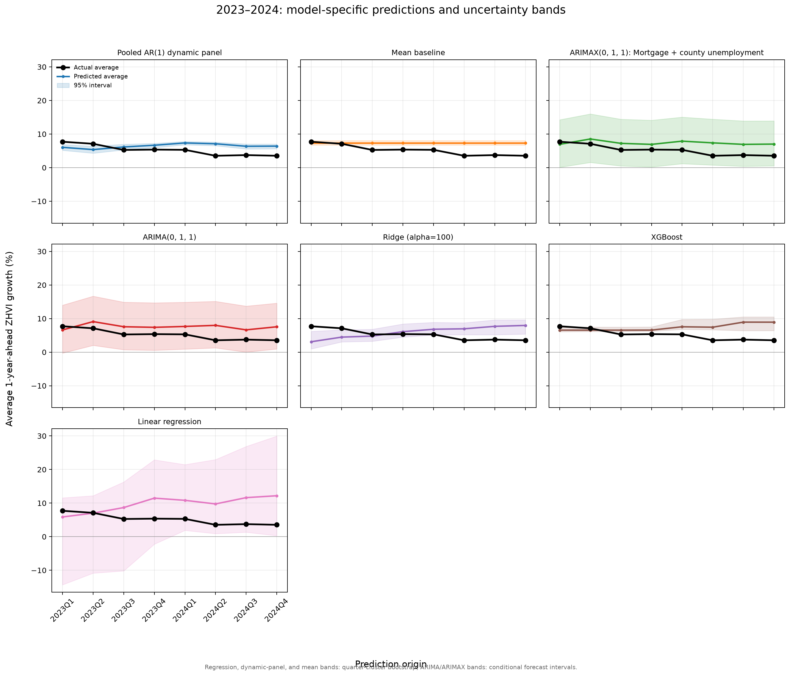

# Checkpoint 3 Model Comparison

## Goal and evaluation design

We compared pooled regression and time-series approaches for one-year-ahead housing outcomes in the nine Ohio counties. For the pooled growth models, the target is the engineered one-year-ahead percentage growth (`zhvi_growth_ahead_1y_pct` or `zori_growth_ahead_1y_pct`). Predicted growth is converted to the Zillow value one year later using the observed origin-quarter value:

`predicted level(t+4) = level(t) × (1 + predicted growth(t+4) / 100)`.

ARIMA and ARIMAX instead forecast the original Zillow level. This lets every model be evaluated on the same future ZHVI or ZORI level. Quarterly rows are Q1–Q4, and the common chronological split is train 2015Q1–2019Q4, validation 2021Q1–2021Q4, and test 2023Q1–2024Q4. The gap years 2020 and 2022 are excluded from scored origins to prevent target-window overlap/leakage and honor the selected split.

The comparison includes a mean baseline, LASSO, Elastic Net, Ridge, XGBoost, pooled AR(1) dynamic panel, ARIMAX, and ARIMA. The five predictor-based pooled models (LASSO, Elastic Net, Ridge, XGBoost, and pooled AR(1)) share this predeclared ten-variable set: `zhvi_growth_qoq_pct`, `zhvi_growth_prev_1y_pct`, `zori_growth_qoq_pct`, `zori_growth_prev_1y_pct`, `nat_mortgage_rate_30y_pct`, `mortgage_rate_change_prev_1y_pp`, `nat_inflation_yoy_pct`, `cty_unemployment_rate_pct`, `cty_unemployment_change_prev_1y_pp`, and `price_to_rent_ratio`. The mean baseline is predictor-free. All pooled models use county fixed effects, with Q1 as the reference when quarter indicators are included. ARIMA/ARIMAX use each county's own history (rather than concatenating counties into a false continuous series); ARIMAX order and a limited economic predictor bundle were selected on validation. Future ARIMAX macro predictors are held at their last observed values, so those forecasts are conditional on a persistence assumption.

For each target/model, versions with and without Q2–Q4 indicators were compared on validation. The model/seasonality selection criterion was **validation RMSE on original Zillow levels**, with MAE as tie-breaker; test data were not used for selection. Reported 95% uncertainty bands are quarter-block bootstrap refit bands for pooled regression models and conditional forecast intervals for ARIMA/ARIMAX. These intervals are not directly equivalent: the time-series intervals condition on the fitted specification, and ARIMAX bands omit uncertainty in future exogenous variables.

## Tentative model choices

| Target | Tentative model | Quarter terms | Validation level RMSE | Validation MAE | Validation R² | Why |
|---|---|---:|---:|---:|---:|---|
| ZHVI | Ridge (alpha=100) | Yes | $5,989 | $4,464 | 0.991 | Lowest validation level RMSE among evaluated models for ZHVI. |
| ZORI | Elastic Net (alpha=0.1, l1_ratio=0.25) | No | $35.30/month | $29.99/month | 0.971 | Lowest validation level RMSE among evaluated models for ZORI. |

These are **tentative prediction choices**, not a claim that either model fully captures the market regime change after 2022. They were selected by the validation criterion above; the 2023–2024 test is retained as an out-of-period assessment and was not used to choose models.

## Test performance on the original level scale

The table reports the locked test-set level metrics for all eight approaches. Lower MAE/RMSE is better; R² is relative to the test-set mean and should be interpreted cautiously because a strong common time trend can make R² look high even when a model misses quarter-to-quarter changes.

| Target | Model | Quarter terms | Test MAE | Test RMSE | Test R² |
|---|---|---:|---:|---:|---:|
| ZHVI | ARIMA | Yes | $9,200.31 | $11,546.58 | 0.971 |
| ZHVI | ARIMAX | No | $8,088.64 | $10,192.02 | 0.977 |
| ZHVI | Elastic Net | Yes | $5,578.63 | $7,279.88 | 0.988 |
| ZHVI | LASSO | Yes | $6,487.17 | $8,429.19 | 0.985 |
| ZHVI | Mean baseline | No | $6,831.66 | $9,154.57 | 0.982 |
| ZHVI | Pooled AR(1) dynamic panel | Yes | $8,013.93 | $10,660.80 | 0.975 |
| ZHVI | Ridge | Yes | $4,736.47 | $6,166.55 | 0.992 |
| ZHVI | XGBoost | Yes | $6,357.47 | $8,377.98 | 0.985 |
| ZORI | ARIMA | No | $43.17/month | $45.89/month | 0.960 |
| ZORI | ARIMAX | No | $12.83/month | $16.10/month | 0.995 |
| ZORI | Elastic Net | No | $23.32/month | $28.89/month | 0.984 |
| ZORI | LASSO | No | $23.87/month | $29.23/month | 0.984 |
| ZORI | Mean baseline | No | $14.62/month | $18.67/month | 0.993 |
| ZORI | Pooled AR(1) dynamic panel | No | $21.76/month | $26.93/month | 0.986 |
| ZORI | Ridge | No | $25.21/month | $31.39/month | 0.981 |
| ZORI | XGBoost | Yes | $14.29/month | $17.75/month | 0.994 |

## Test performance on the one-year growth scale

Because the primary prediction target is one-year-ahead growth, we also convert each predicted future level back into an implied growth rate and report growth metrics. These are **diagnostic test metrics**: model tuning and quarter-term selection above minimized validation level RMSE, not growth-rate RMSE. Negative growth-scale R² for several models shows that the chosen level forecasts can still miss the direction and size of growth changes, especially across a market regime shift.

| Target | Model | Quarter terms | MAE (percentage points) | RMSE (percentage points) | R² |
|---|---|---:|---:|---:|---:|
| ZHVI | Ridge | Yes | 2.002 | 2.521 | -0.634 |
| ZHVI | Elastic Net | Yes | 2.340 | 2.920 | -1.192 |
| ZHVI | XGBoost | Yes | 2.453 | 2.969 | -1.267 |
| ZHVI | LASSO | Yes | 2.659 | 3.242 | -1.703 |
| ZHVI | Mean baseline | No | 2.611 | 3.253 | -1.722 |
| ZHVI | ARIMAX | No | 3.149 | 3.706 | -2.532 |
| ZHVI | Pooled AR(1) dynamic panel | Yes | 3.234 | 3.987 | -3.088 |
| ZHVI | ARIMA | Yes | 3.591 | 4.241 | -3.625 |
| ZORI | ARIMAX | No | 1.003 | 1.246 | -0.328 |
| ZORI | XGBoost | Yes | 1.097 | 1.326 | -0.504 |
| ZORI | Mean baseline | No | 1.127 | 1.401 | -0.680 |
| ZORI | Pooled AR(1) dynamic panel | No | 1.748 | 2.211 | -3.182 |
| ZORI | Elastic Net | No | 1.856 | 2.336 | -3.670 |
| ZORI | LASSO | No | 1.904 | 2.368 | -3.799 |
| ZORI | Ridge | No | 1.997 | 2.489 | -4.303 |
| ZORI | ARIMA | No | 3.422 | 3.637 | -10.323 |

## Figures

The figures below compare the nine-county average actual test series with model-average forecasts. In each panel, the black line is the observed series, the colored line is the forecast, and the shaded region is the model's 95% uncertainty band. The horizontal axis shows the prediction-origin quarter; the vertical axis shows either growth in percent or the predicted future Zillow level, as labeled. Narrower bands indicate less estimated uncertainty under that model's interval method, not guaranteed accuracy.

### ZHVI: one-year-ahead target growth

*Figure 1. Average one-year-ahead ZHVI growth for 2023–2024 test origins. Compare each model's colored forecast with the black observed growth line; the shaded band shows its 95% interval. Values are percentages, and panels identify whether quarter indicators were selected.*

### ZORI: one-year-ahead target growth

*Figure 2. Average one-year-ahead ZORI growth for 2023–2024 test origins. The black line is observed growth, each colored line is a model forecast, and the shaded area is its 95% interval. Values are percentages; compare forecast direction and magnitude with the observed series.*

### Model-specific level forecasts

*Figure 3. Model forecasts of average future ZHVI levels over the test period, shown in U.S. dollars. Pooled growth-model forecasts are converted back to levels for comparison with ARIMA-family level forecasts. The shaded bands show model-specific 95% uncertainty intervals.*

*Figure 4. Model forecasts of average future ZORI levels over the test period, shown in U.S. dollars per month. Pooled growth-model forecasts are converted back to levels; ARIMA-family models forecast levels directly. The shaded bands are model-specific 95% uncertainty intervals.*

### Per-target forecast and interval details

*Figure 5. County-level ZHVI forecasts and intervals for the held-out test quarters. This view complements the county-averaged plot above by showing how errors and uncertainty vary across the nine counties.*

*Figure 6. County-level ZORI forecasts and intervals for the held-out test quarters. Compare the county-specific prediction paths and shaded intervals to see heterogeneity hidden by the nine-county average.*

## Person 4 separate time-series experiment

Person 4's separate experiment compares pooled regression and time-series approaches for one-year-ahead ZHVI growth. Its files are stored in [`results/checkpoint3_model_compare/time_series/`](../results/checkpoint3_model_compare/time_series/), apart from Person 3's growth-target experiment in `results/checkpoint3_time_series/`. The outputs use a different modeling setup and are kept separate.

*Figure 7. Person 4's model-by-model comparison of average one-year-ahead ZHVI growth for the 2023–2024 test origins. In each panel, the black line is observed growth, the colored line is predicted growth, and the shaded region is the model-specific 95% interval. The horizontal axis is the prediction-origin quarter and the vertical axis is growth in percent. The `level_experiment_` filename prefix is retained from the original export; the plotted target is ZHVI growth, as shown on the y-axis.*

## Limitations and interpretation

- There are only nine counties and a short pre-pandemic training window. The 2023–2024 test period follows a different rate and housing-market environment, so it is a meaningful but difficult distribution-shift test.
- The one-year validation period is small. Treat model ordering and quarter-term selection as provisional, and report test results separately rather than selecting on them.
- Ridge and Elastic Net are the tentative choices because they had the best validation RMSE on the level scale for their respective targets. Their growth-rate errors can still be poor; the conclusion should be framed as “selected under the stated validation criterion,” not “best at predicting the 2023–2024 slowdown.”
- Growth and level objectives differ. If the project prioritizes predicting appreciation/deceleration rather than future dollar levels, the team should predeclare growth-rate RMSE as the primary criterion and rerun model selection using validation growth metrics before finalizing the model.
- The bands use different uncertainty procedures across model families and are not directly comparable as calibrated coverage statements. The held-out test period is only eight quarters, so empirical coverage is imprecise.

## Reproducibility and artifacts

Run [`notebooks/pooled_model_comparison_zhvi_1y.ipynb`](../notebooks/pooled_model_comparison_zhvi_1y.ipynb) from the project directory. Input data and predictor definitions are loaded from `processed/` and `metadata/`. The corresponding metric tables, prediction series, interval tables, and plots are stored in [`results/checkpoint3_model_compare/`](../results/checkpoint3_model_compare/). Person 3's original growth-target time-series results remain in [`results/checkpoint3_time_series/`](../results/checkpoint3_time_series/); Person 4's separate time-series experiment outputs are in [`results/checkpoint3_model_compare/time_series/`](../results/checkpoint3_model_compare/time_series/).
