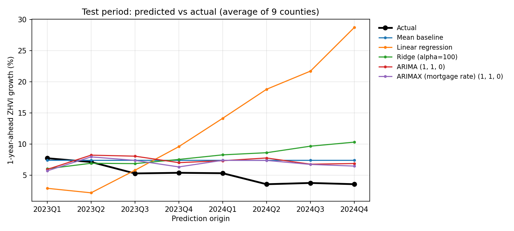

# Checkpoint 3: Exploratory Time-Series Modeling (Person 3)

**Owner:** Yongho Lee
**Code:** [`src/checkpoint3_time_series_zhvi.py`](../src/checkpoint3_time_series_zhvi.py) · **Results:** `results/checkpoint3_time_series/`

**Question:** Do time-series models improve 1-year-ahead ZHVI growth prediction compared with the Linear and Ridge regression baselines?

## Approach

- **Target:** 1-year-ahead ZHVI growth (`zhvi_growth_ahead_1y_pct`). ZHVI was chosen because it is smooth and complete for all 9 counties.
- **Split and metrics:** the shared chronological split (train 2015–2019, validation 2021, test 2023–2024), with MAE, RMSE and R².
- **Time-series models:** per-county **ARIMA** on log ZHVI (one difference plus drift), and **ARIMAX** with the 30-year mortgage rate as an exogenous variable. Each forecast at prediction quarter $t$ is fit on that county's history up to $t$ only and forecasts 4 quarters ahead (rolling origin).
- **Model choice:** the ARIMA order was chosen from five candidates on validation. **(1,1,0)** was selected for both models. Test was scored once.
- **Baselines:** Linear and Ridge regression on all 53 numeric features (Ridge alpha=100, chosen on validation), and the mean of past growth.

## Results

| Model | Validation MAE | Validation RMSE | Test MAE | Test RMSE | Test R² |
|---|---:|---:|---:|---:|---:|
| Mean baseline | 3.82 | 4.18 | 2.48 | 2.94 | −1.22 |
| Linear regression | 20.63 | 22.83 | 10.47 | 13.28 | −44.33 |
| Ridge (alpha=100) | **1.74** | **2.25** | 3.56 | 4.40 | −3.98 |
| ARIMA (1,1,0) | 2.64 | 3.01 | 2.61 | 3.08 | −1.44 |
| ARIMAX (1,1,0) | 2.62 | 2.99 | **2.37** | **2.86** | −1.10 |



## Findings

1. **On test, the time-series models beat both regression baselines.** ARIMAX has the lowest test error (RMSE 2.86), followed by ARIMA (3.08), Ridge (4.40) and Linear regression (13.28).
2. **The gain over the simple mean baseline is small** (RMSE 2.86 vs 2.94). Time-series models are not clearly better than predicting average growth.
3. **Adding the mortgage rate helps:** ARIMAX beats ARIMA on test (2.86 vs 3.08).
4. **Ridge is best on validation but worse on test.** Its test forecasts rise while actual growth falls (7.7% → 3.5%). Linear regression without regularization is unstable with 53 correlated features and 180 training rows.
5. **No model anticipated the 2023–2024 slowdown.** All models over-predict that period, so test R² is negative for every model. MAE and RMSE are more useful for comparison.

## Challenges and limitations

- **Short series:** 44 quarters per county, and a 2021Q1 forecast is fit on only 25 quarters.
- **Regime changes:** training (2015–2019) was stable, validation (2021) was a boom, and test (2023–2024) was a slowdown. Choosing models on one boom year is unreliable.
- **Future mortgage rate unknown:** ARIMAX holds the rate at its last observed value.
- **Numerical convergence:** on the raw log scale, many ARIMA fits did not converge. Rescaling to 100 × log ZHVI fixed this; all fits converge.
- **Annual features in the regression baselines:** the master table repeats annual FHFA and ACS values across all quarters of the same year, so some values were not yet published at the prediction date. This affects Linear and Ridge only.
- Only ZHVI was modeled. The Linear/Ridge results here use all numeric features and may differ from Person 1's official results.

## How to run

```bash
pip install pandas numpy scikit-learn statsmodels matplotlib
python src/checkpoint3_time_series_zhvi.py
```
