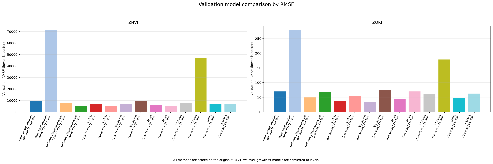
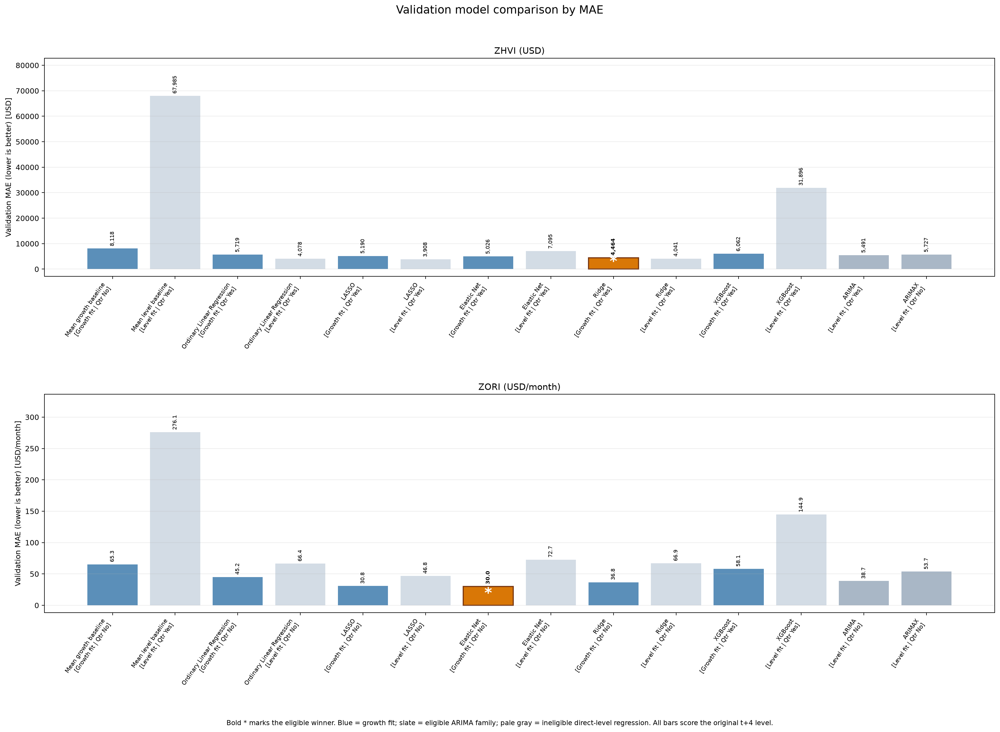
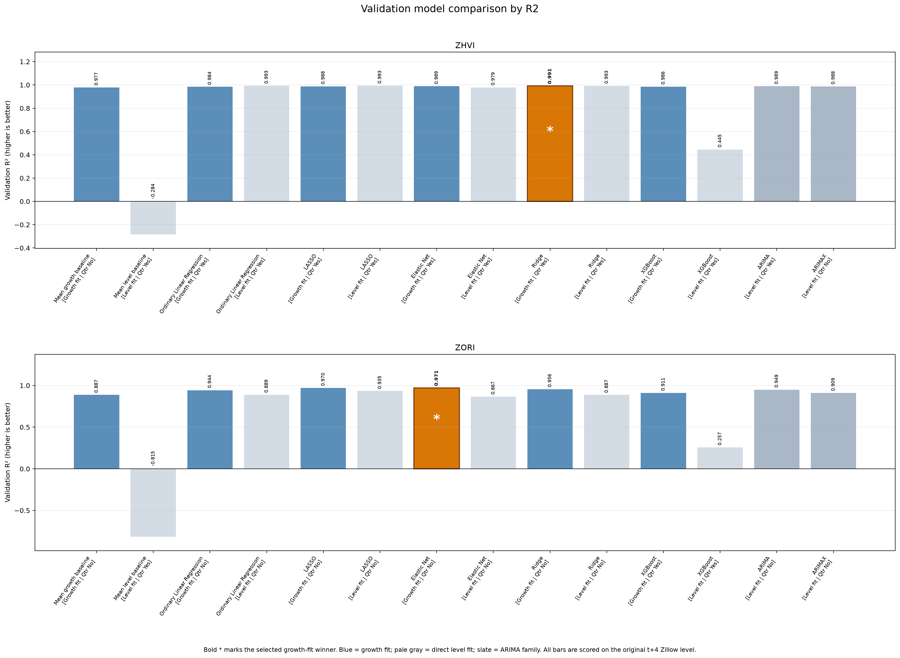
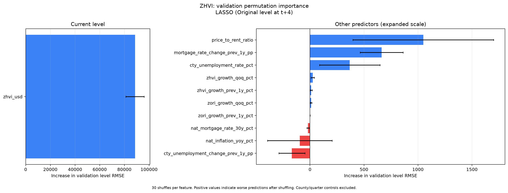
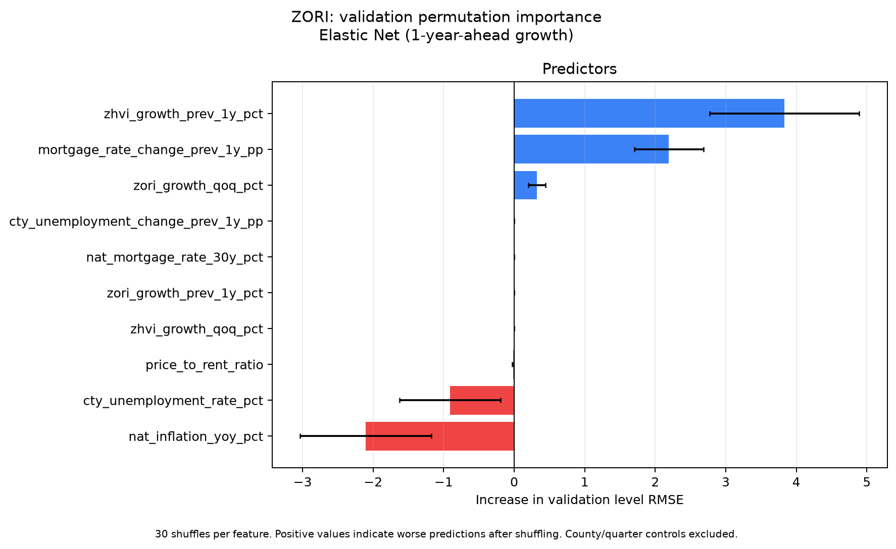
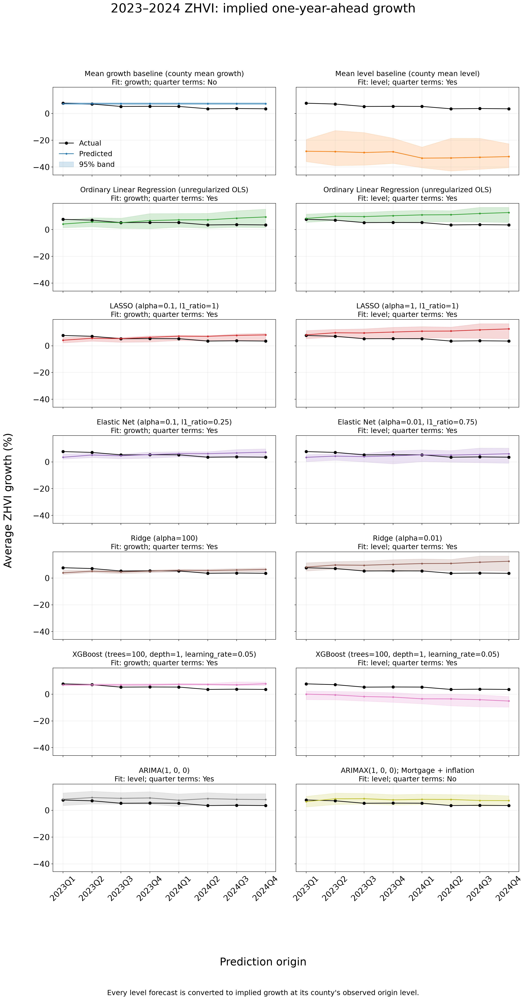
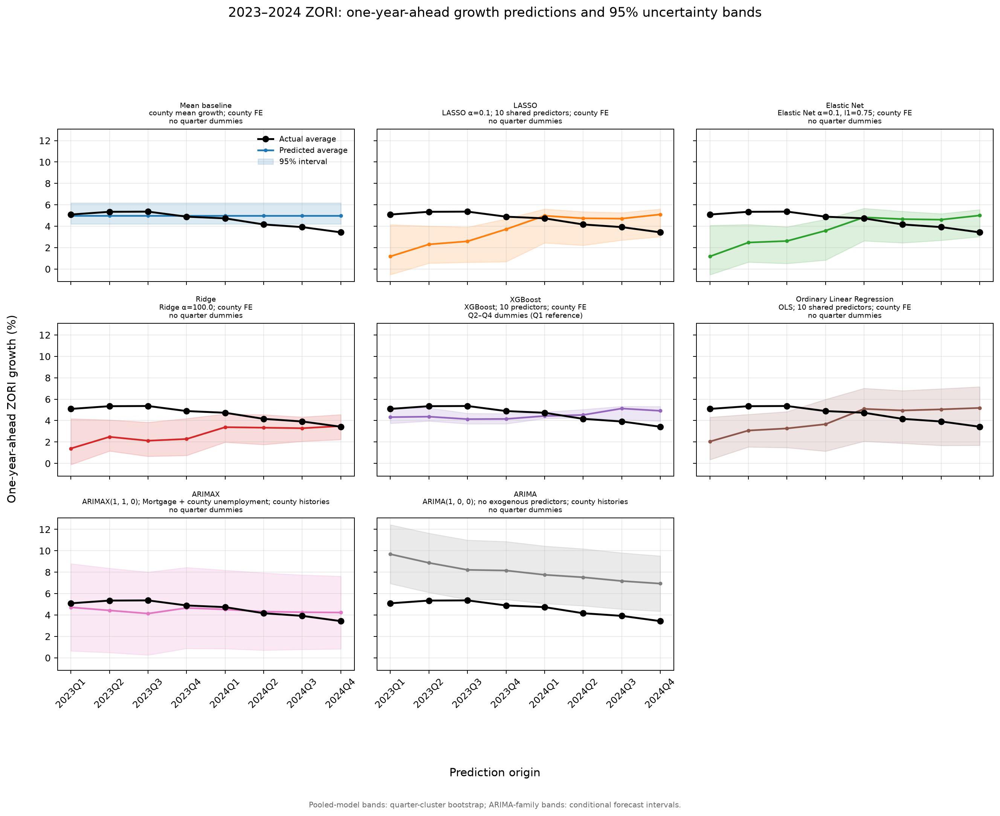
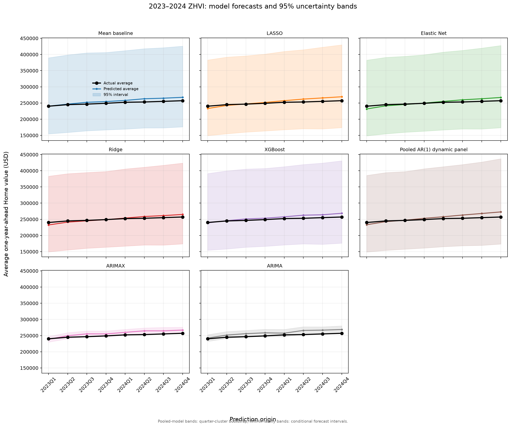
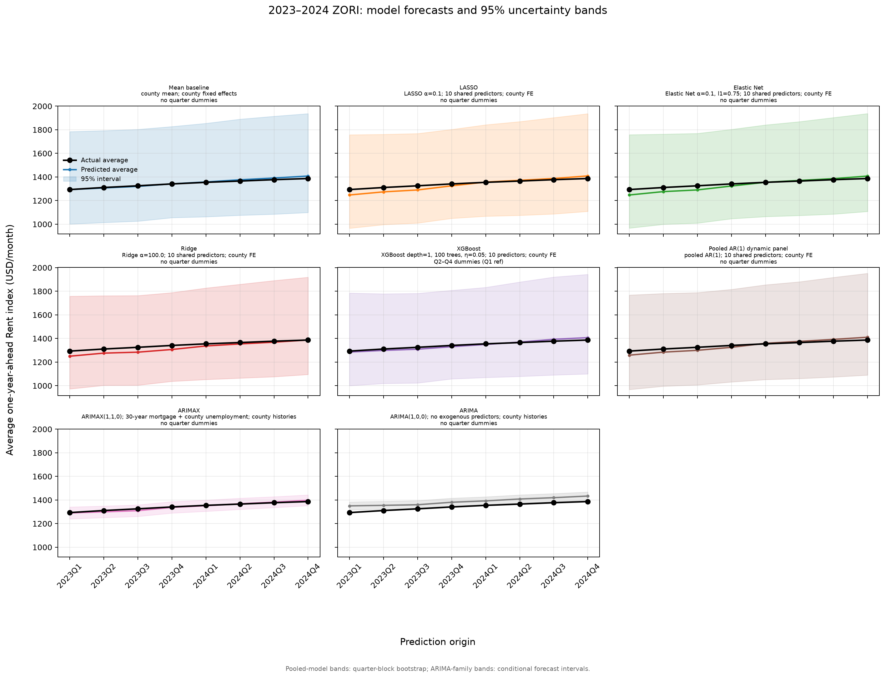

# Checkpoint 4 Model Comparison

## At a glance

| Research outcome | Tentative model | Validation level RMSE | Test level RMSE |
|---|---|---:|---:|
| One-year-ahead ZHVI growth | Ridge, fitted to growth | $5,988.60 | $6,166.55 |
| One-year-ahead ZORI growth | Elastic Net, fitted to growth | $35.30/month | $28.89/month |

These choices minimize **validation RMSE of the future original level** among the eligible models. They are tentative: the 2023–2024 test results had already been seen when the candidate-pool rule was formalized. The test check is therefore descriptive, not an untouched evaluation of that revised rule.

## Research target and selection rule

The primary outcome is one-year-ahead growth: `100 × [level(t+4) / level(t) − 1]`. The candidate pool contains pooled models fitted to growth **and** ARIMA/ARIMAX. The time-series models fit original levels and imply growth from their four-quarter-ahead forecasts. Pooled models fitted directly to future levels are **reference comparisons only**. This is a research-goal rule, not a finding that level fitting is always worse.

All candidates are scored against the **same observed level at t+4**. We select the lowest validation level RMSE, use MAE to break ties, and report R² as supporting evidence. The calculator needs future dollar values, which motivates level-scale scoring without changing the research outcome.

## What each model fits

All eight families forecast a Zillow outcome four quarters after the prediction origin. The six pooled families each have a growth fit and a direct-level fit. The mean baseline names make that distinction explicit.

| # | Model | Fitting target | Selection status |
|---:|---|---|---|
| 1 | Mean growth baseline / Mean level baseline | Growth / level at t+4 | Growth eligible; level reference |
| 2 | Ordinary Linear Regression | Growth and level at t+4 | Growth eligible; level reference |
| 3 | LASSO | Growth and level at t+4 | Growth eligible; level reference |
| 4 | Elastic Net | Growth and level at t+4 | Growth eligible; level reference |
| 5 | Ridge | Growth and level at t+4 | Growth eligible; level reference |
| 6 | XGBoost | Growth and level at t+4 | Growth eligible; level reference |
| 7 | ARIMA | Original level time series | Eligible |
| 8 | ARIMAX | Original level time series with exogenous predictors | Eligible |

For growth fits, `predicted level(t+4) = observed level(t) × [1 + predicted growth / 100]`. Direct-level and time-series fits already output levels. The observed level label is reconstructed from origin level and the supplied growth label, so the score has a common denominator. Ordinary Linear Regression is the pooled OLS model formerly labeled “Pooled AR(1) dynamic panel”; it uses lagged housing growth and county effects but is not a separate AR(1) time-series fit.

## Comparison design

The panel contains nine Ohio counties. The existing chronological split separates one-year target windows:

| Partition | Prediction-origin quarters | County-quarter rows |
|---|---|---:|
| Train | 2015Q1–2019Q4 | 180 |
| Validation | 2021Q1–2021Q4 | 36 |
| Test | 2023Q1–2024Q4 | 72 |

The intervening years are excluded as scored origins. Hyperparameters and the choice of quarter indicators (Q2–Q4, with Q1 as reference) are selected on validation. After freezing specifications, pooled test fits use train plus validation rows. Imputers and scalers are fit on the fitting partition only.

### Shared pooled predictors

The ten origin-quarter features were selected by domain rationale before this expanded comparison, rather than by screening the test set:

| Domain | Predeclared features |
|---|---|
| Housing momentum | `zhvi_growth_qoq_pct`, `zhvi_growth_prev_1y_pct`, `zori_growth_qoq_pct`, `zori_growth_prev_1y_pct` |
| Mortgage and inflation | `nat_mortgage_rate_30y_pct`, `mortgage_rate_change_prev_1y_pp`, `nat_inflation_yoy_pct` |
| Local labor market | `cty_unemployment_rate_pct`, `cty_unemployment_change_prev_1y_pp` |
| Affordability | `price_to_rent_ratio` |

All predictor-based pooled models use this same set and county fixed effects. Direct-level predictor fits also use the **current level of the target Zillow series**; growth fits use that known origin level when converting growth forecasts to future levels. Mean baselines omit numeric predictors but retain county effects.

### Time-series specifications

ARIMA and ARIMAX fit each county's level history separately, avoiding artificial transitions between counties. Their orders, ARIMAX predictor bundle, and quarter terms are selected on validation. Future ARIMAX predictors are held at their origin values; that persistence assumption affects the forecasts. The script reuses the unchanged PR #15 time-series search and forecasts by default, verifies saved outcomes against the current split, and can refit them with `--recompute-time-series`.

For Elastic Net, `l1_ratio=0.75` assigns 75% of the penalty mixing weight to L1 (LASSO) and 25% to L2 (Ridge). These weights are not shares of predictor influence or realized shrinkage.

### Does fitting levels work worse than fitting growth?

**No uniform advantage appears on validation.** Comparing each of the five predictor-based pooled families with itself, growth fitting lowers validation level RMSE in **2 of 5 ZHVI** comparisons and **all 5 ZORI** comparisons. ZHVI direct-level LASSO reaches $5,180, below growth-fitted Ridge's $5,989. Growth fits win all five paired **test** comparisons for both outcomes, but the observed test cannot justify a restriction adopted after those results were seen. Direct-level regressions remain references under the research-goal rule; ARIMA and ARIMAX remain eligible. [Paired validation results](../results/checkpoint3_model_compare/fit_target_paired_validation_comparison.csv).

## Validation selection

| Target | Tentative model | Quarter terms | Validation level MAE | Validation RMSE | Validation R² | Why |
|---|---|---|---:|---:|---:|---|
| ZHVI | Ridge (growth fit; alpha=100) | Yes | $4,464.04 | $5,988.60 | 0.9910 | Lowest validation level RMSE among eligible growth-fit and ARIMA/ARIMAX candidates. |
| ZORI | Elastic Net (growth fit; alpha=0.1, l1_ratio=0.75) | No | $29.99/month | $35.30/month | 0.9711 | Lowest validation level RMSE among eligible growth-fit and ARIMA/ARIMAX candidates. |

The selected eligible model for each outcome also has the lowest validation MAE and highest R² among eligible candidates. If the research-goal restriction is removed, direct-level LASSO wins for ZHVI. Detailed tables: [all validation results](../results/checkpoint3_model_compare/validation_model_comparison.csv), [quarter-term comparison](../results/checkpoint3_model_compare/validation_seasonality_comparison.csv), [eligible metric winners](../results/checkpoint3_model_compare/validation_metric_winners.csv), and [unrestricted metric winners](../results/checkpoint3_model_compare/validation_metric_winners_all_candidates.csv).

**Figure 1 — Validation RMSE.** Top y-axis: ZHVI level error in USD. Bottom y-axis: ZORI level error in USD/month. Both score the **original level at t+4**; growth forecasts are converted to levels first. Values appear above bars. The orange bar and bold asterisk mark the eligible winner. Blue = growth fit; slate = ARIMA/ARIMAX; gray = reference-only direct-level fit. Direct-level ZHVI LASSO has a lower unrestricted RMSE than Ridge but is ineligible under the stated rule.

**Figure 2 — Validation MAE.** Top y-axis: ZHVI level error in USD. Bottom y-axis: ZORI level error in USD/month. Both refer to the **original level at t+4**; lower is better. Values appear above bars; orange and the bold asterisk identify the eligible winner. Labels show fitting target and quarter-term choice.

**Figure 3 — Validation R².** Top y-axis: ZHVI level R². Bottom y-axis: ZORI level R². Both use the **original level at t+4**; higher is better, and zero is the observed-mean reference. Orange and the bold asterisk identify the eligible winner. Direct-level ZHVI LASSO has the highest unrestricted R² but is reference-only.

## Interpreting the winning models

Figures 4–5 show **permutation sensitivity**, not SHAP values, causal effects, or significance tests. Each feature is shuffled 30 times while the model and other columns stay fixed. National features are shuffled by whole quarters so they remain identical across counties; county-level features are shuffled among counties within each quarter. County and quarter indicators stay fixed.

The bars measure the mean percentage change in validation **level-scale RMSE** versus the unshuffled fit. Whiskers are standard deviations across shuffles, **not confidence intervals**. Positive values mean forecasts worsen when a feature is disturbed; negative values mean they improve. Correlation and a 36-row validation sample make rankings uncertain.

**Figure 4 — ZHVI Ridge sensitivity.** The x-axis is the percentage change in validation **original-level RMSE** after panel-preserving shuffling. Darker blue highlights the three largest positive values: county unemployment change (+7.4%), county unemployment rate (+5.7%), and mortgage-rate change (+4.0%). Current ZHVI level converts growth forecasts to levels but is not fitted as a predictor. Bars show predictive sensitivity in this sample, not effect direction.

**Figure 5 — ZORI Elastic Net sensitivity.** The x-axis is the percentage change in validation **original-level RMSE**. Mortgage-rate change (+6.4%) and county unemployment rate (+2.4%) have the largest positive values. Shuffling inflation improves RMSE (−6.6%), suggesting that its fitted contribution may not generalize; this is not a causal finding. Near-zero bars can reflect small coefficients, correlated predictors, or limited validation variation.

[Numerical sensitivity values and permutation rules](../results/checkpoint3_model_compare/winning_model_feature_importance.csv). Multiple forward validation periods would be needed to assess ranking stability.

## Locked test check and R²

| Target | **Validation-selected model** | Quarter terms | Test level MAE | Test level RMSE | Test level R² |
|---|---|---|---:|---:|---:|
| ZHVI | Ridge (growth fit) | Yes | $4,736.47 | $6,166.55 | 0.9917 |
| ZORI | Elastic Net (growth fit) | No | $23.32/month | $28.89/month | 0.9841 |

The 2023–2024 period tests a different housing and rate environment. Direct-level ZHVI LASSO, the unrestricted validation winner, has **$18,072.77** test RMSE versus Ridge's **$6,166.55**. Eligible ZORI ARIMAX beats Elastic Net on test (**$16.10** versus **$28.89/month**), but lost on validation (**$62.50** versus **$35.30/month**). Neither test observation changes a validation-selected choice. Because the candidate-pool rule was formalized after test outcomes were seen, these are descriptive scores. See [all test metrics](../results/checkpoint3_model_compare/metrics.csv) and [growth-scale diagnostics](../results/checkpoint3_model_compare/one_year_ahead_growth_test_metrics.csv).

**Reading out-of-sample R².** `R² = 1 − SSE/SST`, where `SSE` sums squared forecast errors and `SST` sums squared deviations of observed outcomes from their **scored-split mean**. A level R² of `0.992` means SSE is about **99.2% below** that mean-reference SSE. A growth R² of `−0.634` means SSE is **1.634 times** the reference, or 63.4% higher. The scored-split mean defines the metric; it is not available to a forecasting model. Strong level R² can coexist with weak growth R² because persistent county price differences are easier to capture than shifts in growth.

### Test time-series views

**Figure 6 — ZHVI growth forecasts.** The y-axis is **mean one-year-ahead ZHVI growth (%) across nine counties**, `100 × [ZHVI(t+4)/ZHVI(t) − 1]`. The x-axis is the 2023–2024 **prediction-origin quarter**. Black = observed; colored curves = predictions converted to growth where needed. Shading shows approximate 95% bands: quarter-block bootstrap refit bands for pooled fits and conditional forecast intervals for ARIMA/ARIMAX.

**Figure 7 — ZORI growth forecasts.** The y-axis is **mean one-year-ahead ZORI growth (%) across nine counties**, `100 × [ZORI(t+4)/ZORI(t) − 1]`. The x-axis is the prediction-origin quarter, not the future outcome quarter. Black = observed; colored curves = predicted county averages. The band methods differ by model family, so band widths are not directly comparable.

**Figure 8 — ZHVI level forecasts.** The y-axis is **mean original ZHVI at t+4 (USD) across nine counties**. The x-axis is the prediction-origin quarter. Growth forecasts use observed origin ZHVI for conversion; direct-level and time-series fits output levels. Black = observed; colors = predictions; shading = model-specific approximate 95% bands.

**Figure 9 — ZORI level forecasts.** The y-axis is **mean original ZORI at t+4 (USD/month) across nine counties**. The x-axis is the 2023–2024 prediction-origin quarter. Growth fits are converted to levels; direct-level and time-series fits already output levels. Separate panels distinguish each model's fitted target.

## Limits and reproduction

Validation covers only **four quarters and nine counties**. The post-2022 test has a different housing and interest-rate environment; direct-level LASSO's validation-to-test deterioration illustrates the instability. Because the team has inspected the test, an unbiased assessment of the revised selection policy needs new prospective data or a separately designed forward validation period. Pooled bootstrap bands measure refit variation. ARIMA/ARIMAX intervals condition on the chosen specification and, for ARIMAX, fixed future exogenous values. Neither guarantees empirical 95% coverage.

Run the [comparison notebook](../notebooks/pooled_model_comparison_zhvi_1y.ipynb) or [analysis script](../src/model_comparison_analysis.py) from the repository root. The script reads the one-year chronological splits and feature panel and writes [tables and figures](../results/checkpoint3_model_compare/). To rerun the slower ARIMA/ARIMAX search instead of using the checked-in PR #15 results, use `python src/model_comparison_analysis.py --recompute-time-series`. [Person 3's separate time-series results](../results/checkpoint3_time_series/) remain in their own folder.
